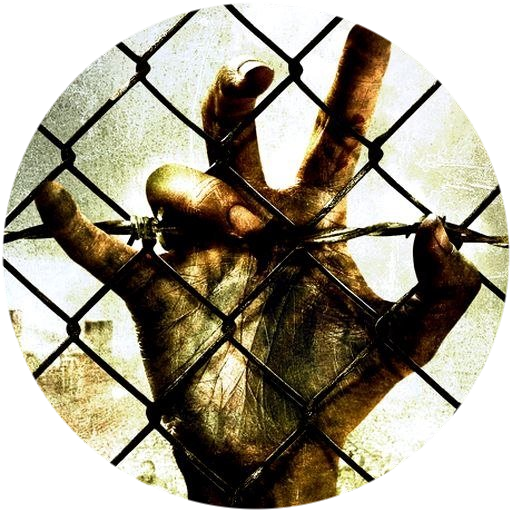

<p align="center">
  
</p>

<h1 align="center">LandOfTheDroid</h1>

<p align="center">
  <strong>Native 64-bit ARM Android Port of <em>Land of the Dead: Road to Fiddler's Green</em> (Unreal Engine 2)</strong>
</p>

---

## Overview

**LandOfTheDroid** is a native, source-level port of the classic 2005 survival horror FPS *Land of the Dead: Road to Fiddler's Green* for modern Android devices. 

Rather than relying on emulation or translation layers like Wine, Box64, or mobox, LandOfTheDroid runs natively on 64-bit ARM processors (`arm64-v8a`). It executes statically recompiled engine and gameplay bytecode coupled with an OpenGL ES 3.0 rendering backend, modern SDL3 runtime, embedded FFmpeg cutscene decoding, and an integrated mobile touch interface.

---

## Technical Architecture & Engineering

### 1. Static Binary Recompilation Core
The original Win32 x86 PE executable (`LOTD.exe`) and accompanying game DLLs (`Core.dll`, `Engine.dll`, `DOTZGame.u`, `DOTZWeapons.u`, `DOTZMenu.u`, `D3DDrv.dll`, `WinDrv.dll`, `ALAudio.dll`) were decompiled and statically recompiled into optimized C source code. This recompiled core executes natively on Android ARM64 CPU architectures without x86 emulation overhead.

### 2. Modern OpenGL ES 3.0 Rendering Pipeline
The legacy DirectX 8 and DirectX 9 fixed-function and programmable pipeline has been ported to OpenGL ES 3.0:
- **Dynamic Lighting & Shading**: Full per-pixel lighting, real-time dynamic light maps, projection decals, and skeletal vertex skinning.
- **AMD FidelityFX CAS (Contrast Adaptive Sharpening)**: Integrated post-processing sharpening filter to enhance texture clarity at high mobile display resolutions.
- **Anti-Aliasing (FXAA)**: Built-in FXAA shader supporting Low, Medium, High, and Ultra presets.
- **Cinematic Color Grading**: Multiple post-FX grading presets including Standard Normal, Romero Zombie Green, High Contrast Noir, Bleached Apocalypse, and Warm Sunset.
- **Aspect Ratio Control**: Native support for modern widescreen (Hor+ scaling) as well as authentic 4:3 Boxed pillarboxed mode.
- **High Refresh Rate Support**: Target frame rate selection for 30 FPS, 60 FPS, 90 FPS, 120 FPS, and Unlimited.

### 3. Touch Interface & Input Subsystem
- **Virtual Movement Joystick**: Dual-zone analog thumbstick featuring a separated, extended sprint pull-radius to eliminate accidental sprinting during close-quarters combat.
- **Precision Aim Surface**: Low-latency camera panning with configurable look sensitivity sliders and invert-look toggles.
- **Customizable HUD Layout**: Built-in visual Touch Controls Layout Editor accessible directly from the settings menu (`[ CONFIGURE TOUCH CONTROLS LAYOUT >> ]`).
- **Physical Gamepad Support**: Plug-and-play support for Bluetooth and USB gamepads (Xbox Series/One, PlayStation DualShock/DualSense, standard Android HID).

### 4. Audio & Cinematics Subsystem
- **3D Positional Audio**: Environmental spatial sound rendered via OpenAL and streaming SDL3 audio backend.
- **Hardware-Decoded Cutscenes**: Embedded FFmpeg library (`libavcodec`, `libavformat`, `libswscale`) delivering smooth, synchronized video playback for intros and level transitions.

### 5. In-Engine Settings & Cheats Integration
- **Fully Integrated Settings Tabs**: Video, Audio, Controls, and Mobile XHYN Settings built natively in UnrealScript.
- **In-Engine Cheats Menu**: Direct toggles for God Mode, Loaded / All Weapons & Ammo, Kung Fu Fists, Kill All Zombies, Fly / Ghost / Walk mode, Slomo Bullet-Time, Behindview 3rd-person camera, and Campaign Chapter Warps.
- **Pause Menu Access**: Cheats button placed directly inside the single-player pause menu below Quit.
- **Quality of Life**: Proximity auto-pickup for weapons and items, smart empty-magazine auto-reload, and auto-save checkpoints.

---

## System Requirements

| Specification | Minimum Requirement | Recommended Specification |
| :--- | :--- | :--- |
| **Operating System** | Android 7.0 (Nougat, API Level 24) | Android 10.0 or higher (API Level 29+) |
| **Processor (CPU)** | 64-bit ARMv8-A Quad-Core (`arm64-v8a`) | 64-bit ARMv8.2-A+ Octa-Core (Snapdragon 7xx/8xx, Dimensity, Tensor) |
| **RAM (Memory)** | **3 GB RAM** | **4 GB to 6 GB+ RAM** |
| **Graphics (GPU)** | OpenGL ES 3.0 compatible (Adreno 505+, Mali-G71+, PowerVR GE8320+) | Adreno 6xx/7xx, Mali-G76/G78/G710+ (for 60-120 FPS & Ultra FX) |
| **Storage Space** | **2.5 GB free internal storage** | High-speed UFS 2.1 / 3.0+ internal flash storage |
| **Architecture** | 64-bit only (`arm64-v8a`) | 64-bit only (`arm64-v8a`) |

> [!IMPORTANT]
> **RAM Notice**: Unreal Engine 2 dynamic level streaming, skeletal mesh caches, and high-resolution texture banks require a minimum of 3 GB of total device RAM. Devices with 4 GB to 6 GB RAM or more will experience significantly smoother frame pacing and zero background low-memory killer (LMK) interruptions during dense zombie horde encounters.

---

## Asset Installation Guide

This repository contains the game executable, native libraries, engine bytecode, and touch framework. Game data assets from the original PC retail release are required.

### Required Directories

From your legally acquired PC installation of *Land of the Dead: Road to Fiddler's Green*, locate the following 10 folders:
1. `Animations/`
2. `Audio/`
3. `Cinematics/`
4. `Help/`
5. `KarmaData/`
6. `Levels/`
7. `Meshes/`
8. `Saves/`
9. `System/`
10. `Textures/`

### Installation Steps

1. Download and install `LandOfTheDead-Android.apk` on your Android device (available on the [Releases](https://github.com/XHYN-PH/landofthedroid/releases) page).
2. Launch the app once to grant Storage access permissions when prompted, then exit.
3. Connect your Android device to your computer via USB (or use an Android file manager).
4. Copy all 10 game asset folders directly into:
   ```
   /sdcard/LandOfTheDead/
   ```
   *(or `/storage/emulated/0/LandOfTheDead/`)*
5. The launcher automatically provides updated engine packages (`DOTZMenu.u`, `DOTZWeapons.u`, `DOTZEngine.u`) and game fonts into `System/` upon launch.
6. Open the app, select your preferred resolution, and tap **LAUNCH GAME**.

---

## Custom Maps & Mods

- **1-Tap Map Installer**: Place custom community `.dz` or `.zip` map archives into your device's `Downloads/` directory and use the built-in installer inside the launcher or in-game drawer to extract them into `/sdcard/LandOfTheDead/Maps/`.
- **Save Backup / Restore**: Backup your save games into timestamped `.zip` archives directly from the launcher utility tab.

---

## Building from Source

### Prerequisites

- Android NDK (r26b or newer)
- Android SDK (compileSdkVersion 34)
- CMake 3.22+
- JDK 17
- Ninja or Make

### 1. Compile Native Shared Library (`libmain.so`)

```bash
mkdir -p build_android && cd build_android
cmake -DCMAKE_TOOLCHAIN_FILE="${ANDROID_NDK_ROOT}/build/cmake/android.toolchain.cmake" \
      -DANDROID_ABI=arm64-v8a \
      -DANDROID_PLATFORM=android-24 \
      -DCMAKE_BUILD_TYPE=Release ..
make -j$(nproc)
cp libmain.so ../SDL3/android-project/app/libs/arm64-v8a/
cd ..
```

### 2. Package the Signed Release APK

```bash
cd SDL3/android-project
./gradlew assembleRelease
```

The compiled, signed release APK is output to:
```
SDL3/android-project/app/build/outputs/apk/release/app-release.apk
```

### Community Maintenance & Release Signing

The official release keystore and signing credentials are provided in the [keys/](keys/) directory (`keys/lotd-release.keystore`). Community developers, modders, and maintainers can compile and sign update APKs with matching cryptographic signatures, allowing users to install community builds directly over previous releases without signature conflicts or losing save data. Details and fingerprints are documented in [keys/README.md](keys/README.md).

---

## Credits & Acknowledgements

- **Port Author**: Developed and maintained by **XHYN-PH**.
- **Original Game**: *Land of the Dead: Road to Fiddler's Green* developed by Brainbox Games, published by Groove Games (2005).
- **Game Engine**: Unreal Engine 2 by Epic Games.
- **Runtime & Platform Layers**: SDL3 and `sdl2-compat` by libsdl-org.
- **Video Decoding**: FFmpeg project.
- **C Recompilation Base**: Built on the open-source decompilation foundation of `lotd-webport` by un4ckn0wl3z.
